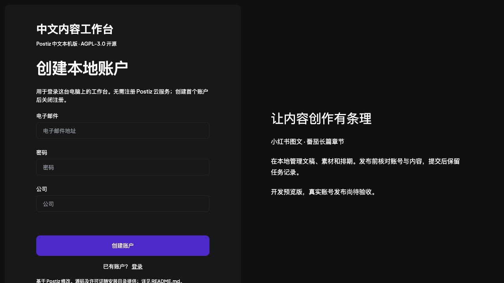

# Postiz 中文本机版

面向中文创作者的本地内容工作台，基于 [Postiz](https://github.com/gitroomhq/postiz-app) 修改。首批适配 **小红书图文笔记**和**番茄小说已有长篇作品的单章发布**。

> 开发预览版：前后端可在本机启动，平台连接和发布适配已加入。离线测试已通过；尚未用真实账号完成发布验收，请勿作为生产发布工具使用。



## 为什么做这个版本

把草稿、图片、章节与排期放在一处管理；运行环境、缓存、登录数据保存在项目目录。首版面向一台电脑上的一个使用者，优先支持原生运行，无需 Docker 或 Postiz 云账号。

首次打开时创建的是**本地工作台账户**。之后分别连接小红书或番茄账号，登录数据不会发送给 Postiz 官方服务；渠道操作仍然会访问相应平台。

## 当前范围

| 功能 | 状态 |
| --- | --- |
| Postiz 草稿、媒体库、日历与排期 | 继承上游；本机服务已启动验证 |
| 小红书图文 | 适配器、标题/话题/AI 声明与确认表单已实现；真实发布待验收 |
| 番茄长篇单章 | 作品选择、TXT 导入、章节序号与 AI 声明已实现；真实发布待验收 |
| 防重复提交 | 同一任务持久化记账；未知结果不自动重复提交 |
| 错过排期 | 超过容忍窗口的任务拒绝自动补发，需人工处理 |
| 番茄审核状态 | 需到作者后台核查；不会把提交成功直接判成审核通过 |
| 独立运行环境 | Node、pnpm、原生服务、两个连接器及数据均使用项目目录 |

首版不包括视频发布、短故事、自动建书、批量发布、云端多人服务。排期依赖电脑开机及服务运行。

## 本机使用

目前的一键原生服务安装仅支持 **macOS Apple Silicon**。需要 Git、Xcode Command Line Tools（编译 Redis）、uv 和 Python 3.12+。详见 [安装与运行说明](LOCAL_BUILD.md)。

```bash
git clone https://github.com/Sundaybro/postiz-cn.git
cd postiz-cn
bash scripts/local/setup.sh
bash scripts/local/run.sh node scripts/local/control.mjs start
```

打开 **http://localhost:4200**。

```bash
# 查看服务与内存
bash scripts/local/run.sh node scripts/local/control.mjs status
# 停止本项目服务
bash scripts/local/run.sh node scripts/local/control.mjs stop
```

真实发布默认关闭。完成登录并检查预览后，可按 [LOCAL_BUILD.md](LOCAL_BUILD.md) 配置启用；每条内容还需明确确认。不要将其他工具的 cookie 文件复制到这里。

## 验证与限制

```bash
bash scripts/local/run.sh node --experimental-strip-types --test apps/local-bridge/test/*.test.mjs
bash scripts/local/run.sh pnpm exec vitest run --config vitest.local-cn.config.mts
```

适配通过 CLI / 浏览器自动化完成，没有承诺获得小红书或番茄官方开放 API 授权。平台改版、验证码和审核可能影响可用性。

原版完整 Jest 测试当前被缺失的 `@nx/jest` 阻塞；桥接测试和本地表单测试单独运行。编译和离线测试不能替代真实账号验收。

## 开源与贡献

欢迎提交可复现的问题、适配修复和文档改进。Issue 请附系统版本、复现步骤、期望与实际结果；日志先去除账号、cookie、token 和文稿。

优先工作：真实账号验收、番茄审核结果核查、手机编辑体验与跨平台安装。公开仓库：[Sundaybro/postiz-cn](https://github.com/Sundaybro/postiz-cn)。欢迎 Star、反馈可复现问题或参与改进。

## 来源与许可证

非官方分支，基于 upstream `a5affe62c74e39c1e7ac960d50d8418b807d532c`。遵守 [AGPL-3.0](LICENSE)，保留 [上游 README](README.upstream.md)、[修改记录](CHANGES_CN.md) 和 [第三方声明](THIRD_PARTY_NOTICES.md)。

`third_party/` 包含连接器的固定源码快照及各自许可证；不是个人账号数据。分发修改版时请提供相应源码；通过网络提供修改后的服务时，也应向用户提供对应源码获取方式。
